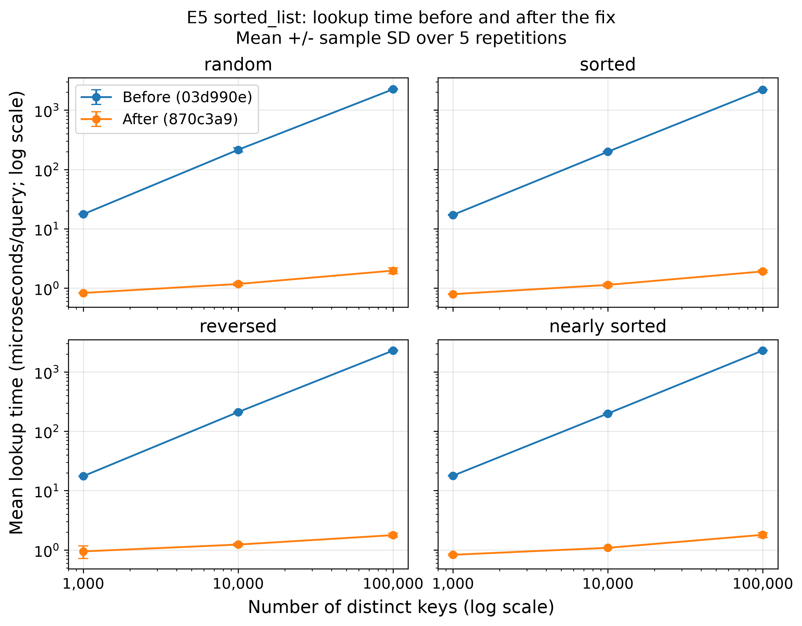
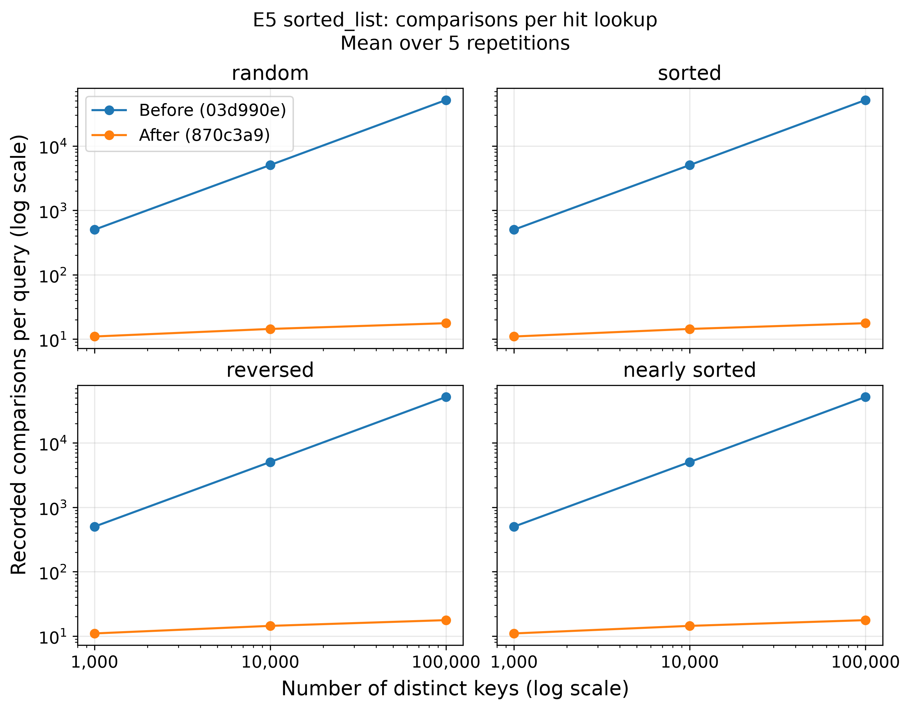
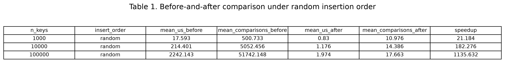

# INC-01: <one-line></one-line>Sorted List Point Lookup Uses a Linear Scan Instead of Binary Search

## Summary

修复前，有序列表索引 sorted_list 虽然按顺序保存键，但 search 方法仍从头开始线性扫描。在 E5 的十万个不同键、随机插入配置下，将线性扫描替换为二分查找后，单次命中查询的平均耗时由 2,242.143 微秒降至 1.974 微秒，约加速 1,135.6 倍；记录的平均比较次数由 51,742.148 次降至 17.663 次。

## Detection

我们首先通过 E5 的原始结果和比较次数汇总发现问题。修复前的代码版本为 03d990e，对应运行 session_id 为 240c73092ceb。

当不同键的数量从 1,000 增加到 100,000 时，每次成功查询的平均比较次数从 500.733 增加到 51,742.148，几乎随数据量成比例增长。这种增长趋势使我们怀疑，查找过程没有充分利用键已经有序的性质。

每种配置均重复测量五次，每次测量包含 1,000 次命中查询。

## Expected vs. observed

这里的 n 表示不同键的数量。对于使用二分查找的有序列表，单次查找应具有 O(log n) 的时间复杂度；定位候选位置后，最终的相等判断至多再增加一次比较计数。

实际观察到，修复前的比较次数近似随 n 线性增长，符合 O(n) 扫描的表现。修复后，数据量增加一百倍，平均比较次数仅从 10.976 增至 17.663，符合二分查找的对数增长趋势。

修复前的代码版本为 03d990e，修复后的代码版本为 870c3a9。两轮实验使用相同的键、查询和随机种子：keys_seed=4300、query_seed=4301、order_seed=4302。

## Evidence

我们使用 results/timings.csv 中的 E5_insert_order 结果。修复前版本为 03d990e（session：240c73092ceb），修复后版本为 870c3a9（session：558bce9a341a）。两轮实验均在 fenghao-pc 的 Docker 环境中运行，使用相同的键、查询和随机种子；每个配置重复五次，每批包含 1,000 次命中查询。



图中每个点表示五次重复测量的平均查询耗时，误差棒表示样本标准差。四种插入顺序下，修复后的查询耗时均明显降低，且随键数量增加而增长得更缓慢。



修复前的比较次数随数据规模近似线性增长，修复后增长缓慢，与二分查找的预期一致。四种插入顺序得到相同的比较次数，因为最终的有序键数组和查询序列相同。



表中统计量均来自五次重复测量。显示数值保留三位小数，提速倍数使用完整精度的平均耗时计算。所有图表均可通过 analysis/INC-01_sorted_list.ipynb 重新生成。

另外，使用与 E5 相同的随机种子 4300 和键生成参数，按升序重建包含 100,000 个键的修复后有序列表索引。调用 `structure_info()` 得到：

```
{'distinct_keys': 100000}
```

该结果确认索引中保存了 100,000 个不同键，与该配置的 n 一致。此结构检查可通过同一 Notebook 重现；耗时与比较次数仍使用正式 E5 实验记录。

## Root cause

Root cause位于修复前版本 03d990e 的 indexes/sorted_list.py，第 53–65 行的 SortedListIndex.search 方法。虽然 self._keys 已经按升序排列，第 57 行仍通过 for i, k in enumerate(self._keys) 从头逐个访问键，第 58 行在每次迭代中增加一次比较计数。

当查询键位于列表后部，或未命中的查询键大于最大键时，代码需要扫描全部不同键。E5 中所有键互异，因此不同键数量等于 n，最坏查找成本为 O(n)。对于均匀分布的命中查询，平均需要检查约 n/2 个键，这与实验中比较次数近似线性增长的现象一致。

同一文件第 27–42 行已经提供了二分查找辅助方法 _bisect_left，它通过不断缩小搜索区间，以 O(log n) 的成本找到第一个大于或等于目标键的位置。但原来的 search 没有调用该方法，因此没有充分利用键的有序性。第 82–83 行的 structure_info 返回 distinct_keys，即 self._keys 的长度；这也说明线性扫描的工作量取决于不同键的数量。

原实现仍能返回正确答案：找到匹配键时，第 59–61 行返回对应的值列表；遇到大于目标的键时，第 62–63 行可以正确提前停止，因为后面的键也不可能匹配。因此，这个问题影响的是查询效率，返回结果仍然正确。

## Fix

修复提交为 870c3a9，提交信息为 Use binary search for sorted list lookups。

在 SortedListIndex.search 中，使用已有的 _bisect_left(key) 替代原来的线性扫描，找到第一个大于或等于目标键的位置 pos。随后检查 pos 是否在列表范围内，并确认该位置的键是否等于目标键。匹配时返回对应的值列表，否则返回空列表。

_bisect_left 已经记录二分查找过程中的比较次数，因此只需要为最后一次候选键的相等性检查额外增加一次计数。修复后，查找的最坏时间复杂度由 O(n) 降为 O(log n)。

```diff
File: indexes/sorted_list.py
Function: SortedListIndex.search()

Before fix: 03d990e
After fix: 870c3a9

Git diff command:
git diff 03d990e..870c3a9 -- indexes/
```

```diff
diff --git a/indexes/sorted_list.py b/indexes/sorted_list.py
index 3519135..4233282 100644
--- a/indexes/sorted_list.py
+++ b/indexes/sorted_list.py
@@ -50,18 +50,41 @@ class SortedListIndex(Index):
             self._values.insert(pos, [value])
         self._size += 1
 
+    # def search(self, key: Any) -> list[Any]:
+    #     # The keys are sorted, so we can stop as soon as we have passed the
+    #     # place where ``key`` would be.
+    #     comparisons = 0
+    #     for i, k in enumerate(self._keys):
+    #         comparisons += 1
+    #         if k == key:
+    #             self.stats.comparisons += comparisons
+    #             return self._values[i]
+    #         if k > key:
+    #             break
+    #     self.stats.comparisons += comparisons
+    #     return []
+
+    # developed
     def search(self, key: Any) -> list[Any]:
-        # The keys are sorted, so we can stop as soon as we have passed the
-        # place where ``key`` would be.
-        comparisons = 0
-        for i, k in enumerate(self._keys):
-            comparisons += 1
-            if k == key:
-                self.stats.comparisons += comparisons
-                return self._values[i]
-            if k > key:
-                break
-        self.stats.comparisons += comparisons
+        '''
+        Find a key using binary search.
+
+        Args:
+            key: The key to look up.
+
+        Returns:
+            The stored values for this key, or an empty list if absent.
+        '''
+        # the position of the first stored key >= key.
+        pos = self._bisect_left(key)
+
+        # pos may equal the list length when every stored key is smaller.
+        if pos < len(self._keys):
+            # binary search already counted its work; count this final key check.
+            self.stats.comparisons += 1
+            if self._keys[pos] == key:
+                return self._values[pos]
+
         return []
 
     def range_search(self, lo: Any, hi: Any) -> list[Any]:


```


## Verification

修复前后的验证均在同一台机器 fenghao-pc 上进行，使用相同的 E5 工作负载，包括 1,000、10,000 和 100,000 个不同键，以及 random、sorted、reversed 和 nearly_sorted 四种插入顺序。键生成、查询生成和插入顺序使用的随机种子分别为 4300、4301 和 4302。每个配置重复测量五次，每次查找测量包含 1,000 次命中查询。

对比的代码版本分别为修复前的 03d990e 和修复后的 870c3a9。在 100,000 个键、随机插入顺序下，平均每次查询耗时从 2,242.143 微秒降至 1.974 微秒，按照未四舍五入的均值计算，提升约 1,135.632 倍。平均每次查询的比较次数从 51,742.148 降至 17.663。四种插入顺序均表现出相同的比较次数变化，支持修复后的查找工作量符合 O(log n) 的预期。

修复后使用 docker compose run --rm app python -m pytest 运行项目测试，结果为 168 passed, 3 skipped。三个跳过项来自测试套件对无序索引跳过的范围查询结果排序检查，属于预期行为。测试结果表明，这次修改在降低查找工作量的同时，通过了现有的正确性检查。

## Impact on recommendations

这个缺陷可能影响 F1（精确歌曲查找）的索引推荐。修复前，sorted_list 的点查找成本为 O(n)，实验结果会低估有序列表应有的查询性能，可能导致我们过早排除该索引。修复后，点查找成本降为 O(log n)，因此应使用修复后的测量结果，与哈希表、AVL 树和 B+ 树等索引重新比较。

对于 F2（前缀查询）和 F3（范围查询），本次 E5 的命中点查找数据不能直接说明这些操作也获得了相同的性能提升。这两项功能的推荐应根据对应查询操作的独立测量确定。

对于 F4（夜间批量导入），本次修复没有消除有序列表插入新键时可能产生的元素移动成本。因此，点查找的加速不能直接视为导入速度的提升。F4 的推荐还需要结合 E1 的构建时间与内存测量，以及 E5 中不同插入顺序下的构建结果。最终选择应基于各索引完成修复后的可比数据。

## Why the tests didn't catch it

现有测试主要检查查询结果是否正确，没有对 search 随数据规模增长时的比较次数设置 O(log n) 的上限。原来的线性扫描仍然能够正确返回匹配键的值列表，并在找不到目标键时返回空列表，因此能够通过正确性测试。

能够发现这个问题的是基于比较计数的复杂度回归测试。例如，分别构建包含 1,024、2,048 和 4,096 个不同键的有序列表，然后查询最大键，以及一个大于最大键的不存在键。每次查询前重置统计计数，并检查查找结果与比较次数。对于当前的二分查找实现，可以将单次查询的比较次数上限设为 ceil(log2(n + 1)) + 1，其中 ceil 表示向上取整，额外的 1 用于最终候选键的相等性检查。

原来的线性扫描在这些查询中需要检查全部 n 个键，会超过上述上限。使用比较次数作为断言，也能减少机器性能和系统负载对测试判断的影响，比固定耗时阈值更稳定。
