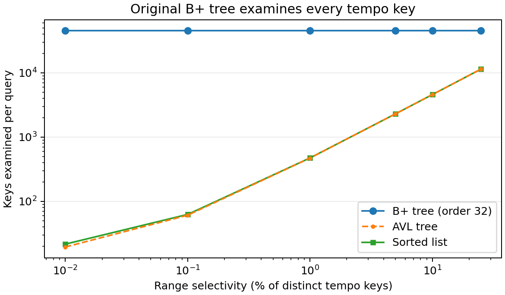

# INC-04: B+ tree scans every leaf for range and prefix queries

## Summary

The order-32 B+ tree examined all 45,653 distinct tempo keys to answer a range covering just five of them in E3. The fix routes directly to the lower bound and follows the sorted leaf links until the upper bound is passed. In the paired E6 measurement, the order-32 median range query dropped from 1.85 ms to 52 µs. The inherited prefix operation uses the same path.

## Detection

E3 showed nearly flat B+ tree latency at the low end of the selectivity sweep. On `cimy-mbp`, the 0.01% range took 1,271 µs per query, versus 1,304 µs at 1% selectivity, even though the number of matching tempo keys went from 5 to 457. The tree had height 4, yet every query visited 2,197 nodes and examined 45,653 keys across all six selectivities. The AVL tree in the same E3 run examined about 19.5 keys per query for the five-key range. E4 showed the same symptom for prefixes of every tested length.



Figure 1. The sorted list and AVL tree examine more keys as selectivity increases, and their curves nearly overlap. The original B+ tree always examines all 45,653 tempo keys. The figure and the table below are reproduced by [INC-04_bplus_scan.ipynb](../analysis/INC-04_bplus_scan.ipynb).

## Expected vs. observed

Let `d` be the number of distinct keys, `m` the tree order, `h` the height, `k` the number of matching distinct keys and `r` the number of row IDs returned. A query should use at most `O(h log m)` key examinations to find its starting position, then `O(k + 1)` examinations to collect matches and detect the end. Copying their row IDs takes `O(r)` time. Node visits should consist of the descent and the relevant leaves, with possibly one more leaf to detect the end. The original query performed `d` key examinations and visited every node even when `k` was zero or very small.

## Evidence

These Docker measurements used file order, 200 queries per batch and five batches per setting. Times are medians and interquartile ranges across batches. Counters are per query.

| Workload and version | Selectivity or prefix length | Height | Median [Q1, Q3] (µs/query) | Keys examined/query | Nodes visited/query |
| --- | ---: | ---: | ---: | ---: | ---: |
| E3 `5a59833` | 0.01% | 4 | 1,270.82 [1,257.25, 1,288.78] | 45,653 | 2,197 |
| E3 `5a59833` | 1% | 4 | 1,303.59 [1,299.92, 1,303.85] | 45,653 | 2,197 |
| E4 `751ca9a` | 3 characters | 4 | 3,577.02 [3,564.66, 3,579.72] | 72,396 | 3,497 |

The E3 input has 114,000 rows and 45,653 distinct tempo keys. The E4 input has 113,999 indexed rows and 72,396 distinct names. Duplicate rows share a leaf key. The comparison counter equalled the distinct key count in both experiments, which identifies the work as a whole-tree scan.

## Root cause

In the original `indexes/bplus_tree.py:173–189`, `range_search` calls `_collect_range` on the root for every valid interval. The recursive call at lines 188–189 descends into every child without consulting separator keys. The loop at lines 183–186 checks the keys in every leaf, including leaves that cannot contain matches. This returns the correct row IDs in sorted key order because children and keys are traversed in order. It also discards the work already done to maintain separators and linked leaves. `indexes/base.py:100–102` implements `prefix_search` by calling `range_search` with string bounds, so the prefix operation inherits the scan.

## Fix

Use `_find_leaf(lo)` to reach the first possible leaf and `_bisect_left` to find the first slot at or above `lo`. Scan forward within the leaf, then use `next` to continue in key order. Return as soon as a key exceeds `hi`. Extending the result with the entire value list preserves insertion order among duplicate keys. The descent counts the starting leaf, and the scan counts each subsequent leaf once. It counts each key examined, including the first key beyond `hi` when present.

The fix is committed in `0d49e62`.

```diff
diff --git a/indexes/bplus_tree.py b/indexes/bplus_tree.py
index 7005649..da1045c 100644
--- a/indexes/bplus_tree.py
+++ b/indexes/bplus_tree.py
@@ -175,3 +175,2 @@ class BPlusTreeIndex(Index):
-        if lo <= hi:
-            self._collect_range(self._root, lo, hi, result)
-        return result
+        if not (lo <= hi):
+            return result
@@ -179,11 +178,17 @@ class BPlusTreeIndex(Index):
-    def _collect_range(self, node: _Node, lo: Any, hi: Any, out: list[Any]) -> None:
-        """Gather values for keys in [lo, hi] from the subtree under ``node``, in key order."""
-        self.stats.nodes_visited += 1
-        if isinstance(node, _Leaf):
-            for key, values in zip(node.keys, node.values):
-                if lo <= key <= hi:
-                    out.extend(values)
-            self.stats.comparisons += len(node.keys)
-            return
-        for child in node.children:
-            self._collect_range(child, lo, hi, out)
+        leaf: Optional[_Leaf] = self._find_leaf(lo)
+        start = self._bisect_left(leaf.keys, lo)
+        while leaf is not None:
+            stop = len(leaf.keys)
+            for i in range(start, stop):
+                if hi < leaf.keys[i]:
+                    self.stats.comparisons += i - start + 1
+                    return result
+                result.extend(leaf.values[i])
+            self.stats.comparisons += stop - start
+
+            # _find_leaf counted the first leaf. Count each linked leaf once.
+            leaf = leaf.next
+            if leaf is not None:
+                self.stats.nodes_visited += 1
+            start = 0
+        return result
```

## Verification

E6 used the same 1% tempo ranges (457 distinct keys per range), seed 4320, 200 queries per batch and five replicates before and after on `zuoheng-mbp`. Both versions had height 4 at order 32. The table reports the median and interquartile range across the five batches, followed by the deterministic counters per query.

| Version / session | Median [Q1, Q3] (µs/query) | Keys examined/query | Nodes visited/query |
| --- | ---: | ---: | ---: |
| `a152bd8` / `449665fab6ee` | 1,851.46 [1,840.70, 1,857.16] | 45,653.00 | 2,197.00 |
| `0d49e62` / `1873dc08b837` | 51.90 [51.37, 56.16] | 473.82 | 25.01 |

The median time dropped by a factor of 35.7. The keys examined fell by a factor of 96.4, consistent with examining the 457 matching keys plus about 17 examinations to find the starting key and detect the end. Node visits fell by a factor of 87.8. The paired table and range work plot cover all nine orders. [Notebook](../analysis/E6_bplus_order.ipynb) · [Paired table](../analysis/tables_member_c/E6_before_after.csv) · [Range work plot](../analysis/figures_member_c/E6_range_work.png)

The CORE runs on the same Mac verify the inherited prefix path. Each version used the same 200 three-character prefixes and five replicates. The order-32 B+ tree median fell from 5,154.88 to 20.83 µs per query, about 247 times faster.

| Version / session | Median [Q1, Q3] (µs/query) | Keys examined/query | Nodes visited/query |
| --- | ---: | ---: | ---: |
| `f5dfa0b` / `214c115ab1fa` | 5,154.88 [5,089.90, 5,648.24] | 72,396.00 | 3,497.00 |
| `0d49e62` / `60616fab1fe7` | 20.83 [20.72, 21.25] | 167.57 | 10.93 |

The same-machine comparison uses the CORE rows. [Part E hardware notebook](../analysis/Part_E_hardware.ipynb) · [Paired table](../analysis/tables_member_c/CORE_before_after.csv)

The Docker test suite passed with 168 tests and 3 expected skips. The supplied tests cover inclusive bounds, ordering, empty or reversed ranges, duplicate values, and inherited prefix searches. A separate untimed check compared the results with an ordered mapping on all nine E6 orders using duplicate keys, gaps and randomly selected bounds.

## Impact on recommendations

The scan made B+ tree look disproportionately expensive for search as you type (F2) and workout tempo ranges (F3), particularly for narrow queries. B+ was the fastest candidate for the tested three-character prefix in the fixed CORE session, at 20.83 µs per query versus 31.42 µs for the sorted list. For the 1% CORE tempo range, the sorted list was 56.15 µs per query and the order-32 B+ tree was close at 57.58 µs. Within E6, order 512 had the fastest median range query before the fix, when larger leaves reduced the number of nodes in the full scan. Order 128 had the lowest observed median after the fix at 46.93 µs, close to order 64 at 47.16 µs. F1 and F4 use the point lookup and insert paths.

## Why the tests didn't catch it

The tests check the contents and order of the returned IDs. The full scan produces exactly those answers. A counter-based regression check could grow the tree while keeping a range at a fixed width. It would verify that key examinations and node visits stay near the search path and the few leaves holding matches.
