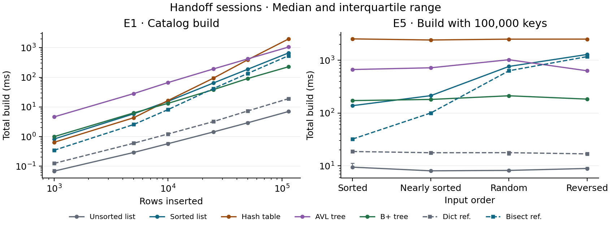
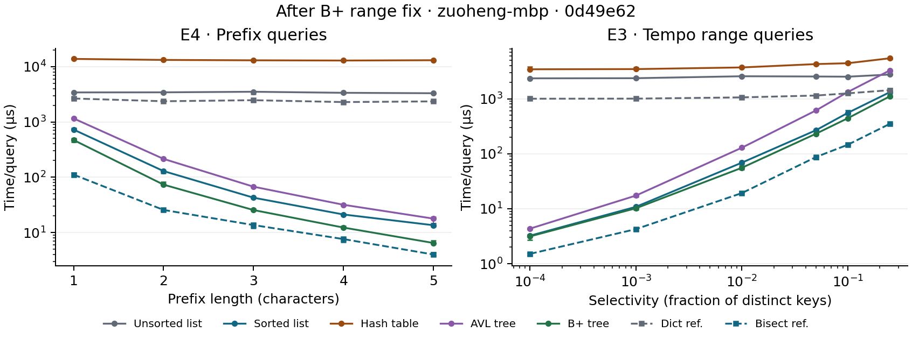
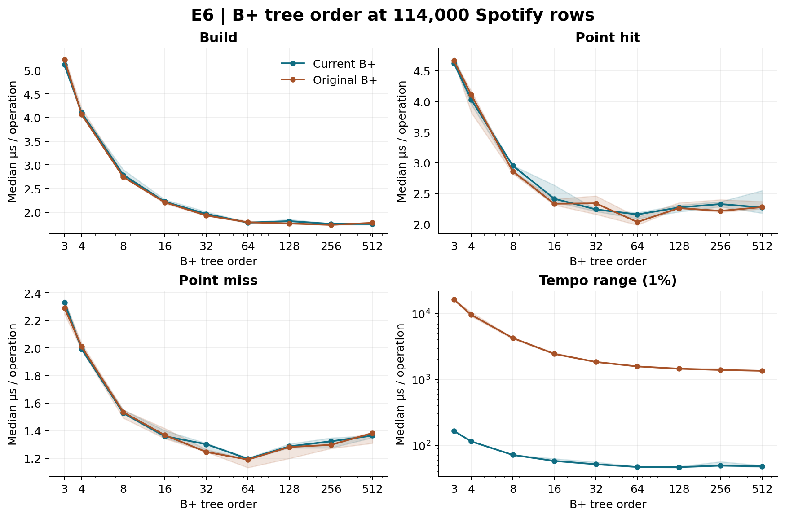
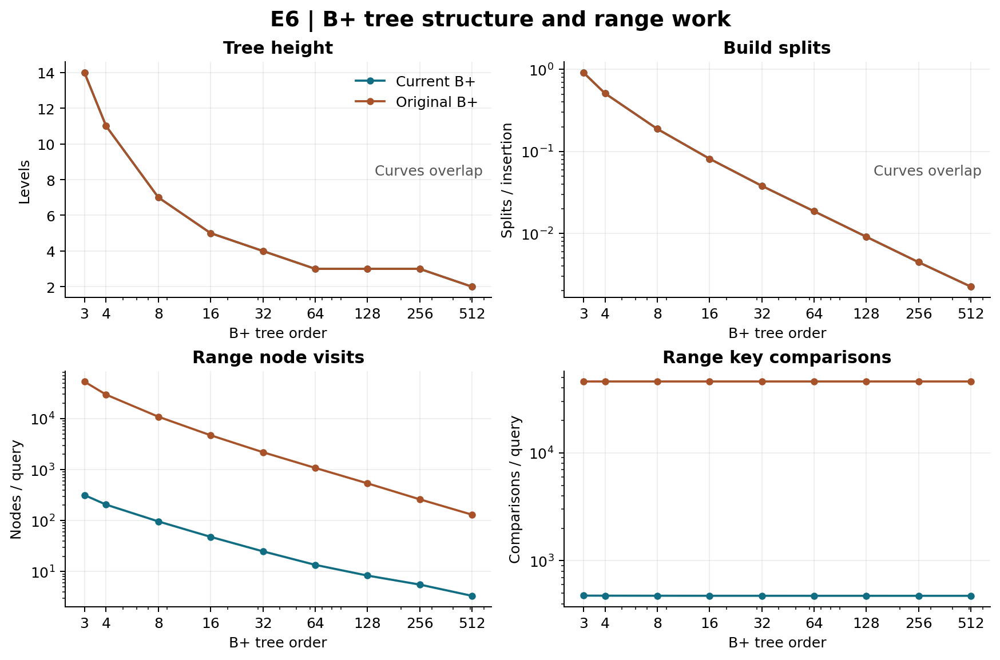
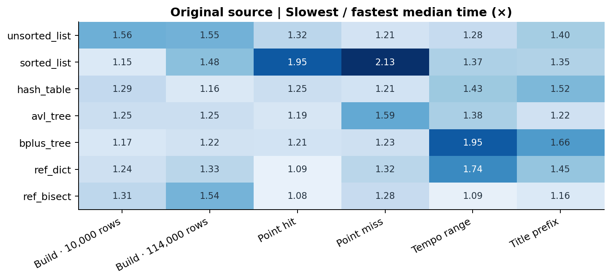
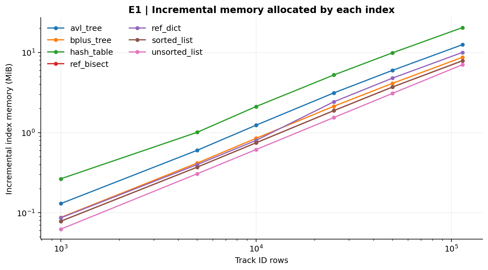

# Index It
## 1. Executive summary

**Spotify index experiments · Team integration draft.** Fenghao, Cimy and Zuoheng.

| Feature | Candidate | Evidence |
| --- | --- | --- |
| F1 Track page | Hash table | E2 at 114,000 rows measured 681 ns/hit and 507 ns/miss. |
| F2 Search as you type | B+ tree | E4 median 25.46 µs/query for three-character prefixes. |
| F3 Workout mode | B+ tree | E3 median 442.99 µs/query at 10% distinct-key selectivity. |
| F4 Catalog import | Unsorted list for ingest alone | E1 median 7.03 ms for 114,000 records. E5 ranked it first across all tested arrival orders. |

INC-01 replaced linear point lookup in the sorted list with binary search. INC-04 bounded B+ range and prefix traversal by the query's endpoints. Recommendations describe the measured revisions. The hash-table and AVL investigations and teammate final CORE sessions remain open.

<!-- page -->

## 2. Index explanations (Part A)

The Part A section is reserved for the teammate assigned to it. The existing hash table and AVL writeup is in `report/partA_hash_avl.md`.

## 3. Methods

Spotify supplies 114,000 inserted records. There are 89,741 distinct track IDs and 45,653 distinct tempos. Title indexing excludes one blank title and leaves 72,396 distinct names. A range covering 1% of distinct tempo keys can return more or less than 1% of records because the number of rows per tempo varies.

| Experiment | Workload | Varied |
| --- | --- | --- |
| E1 | Build from track IDs in file order and trace index allocations separately | Six sizes from 1,000 to 114,000 rows |
| E2 | 1,000 track ID hits and 1,000 misses per batch, generated from distinct IDs | E1 sizes and 0% or 100% hit rate |
| E3 | 200 ranges over all tempo rows | Six selectivities from 0.01% to 25% of distinct tempos |
| E4 | 200 title prefixes per length, each sampled from eligible titles | Lengths 1 through 5 |
| E5 | Build from distinct random 8-character keys and time 1,000 hits | Three sizes from 1,000 to 100,000, four input orders |
| E6 | B+ only. E2 sizes and point batches, plus E3 at 1% | Orders 3, 4, 8, 16, 32, 64, 128, 256 and 512 |

We prepared keys and query batches outside the timer, used the provided timing functions with garbage collection paused, and ran five replicates per configuration in the supplied Docker environment. Each timed build started with a fresh index. Query counters were reset before each batch. We report medians and the first and third quartiles. For growth, we fit a line to log time versus log size using the six size medians where available. Build total and per query time are separate quantities.

E6 reuses the E2 seeds 4310 and 4311 and the E3 seed 4320. Each 1% tempo range includes 457 distinct tempos before accounting for duplicates. E5 holds the key set and query batch fixed while changing the insertion order. Seed 4300 generates keys, 4301 generates queries, and 4302 arranges keys, including a 5% swap fraction for the nearly sorted input.

<!-- page -->

## 4.1 Build cost, memory and input order

E1 (`03d990e` on fenghao-pc, session `63191d74d176`). At 114,000 rows the unsorted list took 7.03 [6.95, 7.08] ms, B+ 227.62 [226.92, 228.77] ms and hash 1,980.00 [1,970.28, 1,987.17] ms. Fitted build-total slopes were 0.98 for unsorted, 1.15 for B+, 1.73 for hash and 1.06 for dict. The hash build's repeated rehashes as capacity increases in fixed steps are consistent with faster than linear growth.

E5 (`870c3a9` on fenghao-pc, session `558bce9a341a`). At 100,000 distinct keys, the B+ median build ranged from 172.2 to 212.3 ms across the four orders. Sorted-list build was 9.33× slower for descending input than ascending input. B+ height stayed at 4, with 4,834-6,661 splits. AVL recorded 1,025,590-1,462,745 rotations. The unsorted list led at every tested size and order.

<!-- page -->

## 4.2 Lookup, range and prefix

E2 (`0ff4b8e` on cimy-mbp, session `721d1d950c87`). Hash led the five candidates at all six sizes for hits and misses. At 114,000 rows it took 681 [680, 698] ns/hit and 507 [506, 538] ns/miss. The unsorted hit slope was 1.05 against 0.23 for the hash table.

E3 (`0d49e62` on zuoheng-mbp, session `4bfebe4a211e`). At 1%, the B+ tree led with 55.63 [52.26, 60.55] µs/query. At 10%, the B+ tree took 442.99 [439.29, 445.33] µs/query and the sorted list took 554.53 [510.35, 613.08] µs/query. The B+ tree led at every tested setting.

E4 (`0d49e62` on zuoheng-mbp, session `e32f04a9efaa`). At three characters, the B+ tree took 25.46 [25.45, 26.57] µs/query and the sorted list took 42.61 [42.08, 43.67] µs/query. The B+ tree led at every tested setting.

<!-- page -->

## 4.3 B+ tree order sweep (E6)

E6 sessions on zuoheng-mbp: `a152bd8` / `449665fab6ee`, `0d49e62` / `1873dc08b837`. Each ran 171 configurations with five batches. Order 32's fixed build-total slope was 1.13 and its point-hit slope was 0.19. Wider nodes reduce height and node visits. The binary searches within those nodes and shifting during insertion still cost work. The point-hit leader shifted from order 128 at 1,000-10,000 rows to 256 at 25,000-50,000 and 64 at 114,000. The best measured order is workload and size dependent. An asterisk marks overlapping IQRs.

| Operation | Best order | Median [Q1, Q3] | Runner-up order |
| --- | --- | --- | --- |
| Build (ms total) | 512 | 199.77 [198.22, 200.01] | 256* |
| Hit (µs/query) | 64 | 2.16 [2.09, 2.19] | 32 |
| Miss (µs/query) | 64 | 1.20 [1.19, 1.20] | 128 |
| 1% tempo (µs/query) | 128 | 46.93 [46.14, 47.88] | 64* |

<!-- page -->

## 5. Performance incidents

### INC-01 · Sorted list point lookup

Fenghao's E5 measurements at 100,000 synthetic keys in random input order found 51,742.148 comparisons per hit with the original scan and 17.663 with binary search. The corresponding means were 2,242.143 and 1.974 microseconds per hit. The two sessions used the same seeds on fenghao-pc. See `analysis/INC-01_sorted_list.ipynb` and the full incident report.

### INC-04 · B+ range and prefix traversal

The original B+ implementation recursively visited every subtree for every valid range. Cimy's E3 recorded 45,653 key comparisons and 2,197 nodes per query at each of the six selectivities. E4 showed the same pattern for prefix queries, which delegate to range search. The fix descends to the leaf containing the lower bound, finds the first eligible key there by binary search, and follows the leaf links until it passes the upper bound. Values for duplicate keys remain in insertion order.

At order 32, the same-machine E6 1% range median fell from 1,851.46 to 51.90 µs/query (35.7×). Key examinations fell from 45,653 to 473.8 and node visits from 2,197 to 25.0. On C's CORE, the B+ prefix median went from 5,154.88 to 20.83 µs/query. The Docker correctness suite passed 168 tests with 3 expected skips.

<!-- page -->

## 6. Hardware comparison

Each original CORE used Python 3.13.18 and hash seed 0. Fenghao and Zuoheng share the exact `f5dfa0b` version. Cimy's `03d990e` has identical index, CORE, timing, loader and Docker source, verified by Git objects. We retain both recorded version IDs. Current-source CORE is available for Zuoheng.

| Machine | Host CPU and RAM | Docker CPU and RAM | CORE versions |
| --- | --- | --- | --- |
| fenghao-pc | Intel Core i7-13700KF, 31.83 GB | 24 vCPU, 15.53 GiB | `f5dfa0b` |
| cimy-mbp | Apple M4 Pro, 24 GB | 14 vCPU, 7.75 GiB | `03d990e` |
| zuoheng-mbp | Apple M3 Pro, 18 GB | 12 vCPU, 7.75 GiB | `f5dfa0b`, `0d49e62` |

All 150 counter comparisons agreed across the two exact-version runs. Across all three original machines, 150/150 counter/config combinations also agreed. The slowest-to-fastest median ratios ranged from 1.08× (bisect point hit) to 2.13× (Sorted list point miss). The fastest index was the same on all three machines for all six workloads. Six of the 42 individual index and workload ranks varied. Median per-configuration CV (sample SD divided by mean) was cimy-mbp 5.08%, fenghao-pc 3.28%, zuoheng-mbp 5.40%. Full per-index ratios, ranks and CVs are in Part_E_hardware.ipynb and its CSV exports.

E1 traced the extra allocation once per configuration. At 114,000 rows it ranged from 7.06 to 20.45 MiB. In the smallest Docker memory budget, the largest index used 0.258% and would reach that full budget at about 44.2 million rows under a linear extrapolation. Actual pressure could begin sooner because the data, runtime, and peak build allocations share the budget. Measured index sizes make RAM capacity an unlikely driver of the CORE timing spread.

<!-- page -->

### Hardware measurements by workload

<!-- page -->

## 7. Recommendations and reference implementations

**F1. Track page.** Choose the hash table for point lookups. It led hits and misses throughout E2. The full-data build cost was 1,980.0 ms and the structure used 20.45 MiB. AVL is an ordered alternative. Hash scans the key set for range and prefix workloads.

**F2. Search as you type.** Choose the B+ tree at its tested default order of 32 for the measured prefix mix. The sorted list was the runner-up at three characters. Popular short prefixes return more rows. If the catalog changes often, include update cost in the comparison.

**F3. Workout mode.** Choose the B+ tree at its tested default order of 32 near 10% selectivity, with the sorted list second in E3. In this dataset 125-135 BPM covers 10.65% of distinct tempos and 13.85% of rows. For smaller windows, consult the E3 sweep. The B+ fix primarily improves narrow queries.

**F4. Catalog import.** Choose the unsorted list for append-only import. At 114,000 records it used 7.06 MiB and finished first in E1. Searches still scan the records. If the index must serve ordered queries immediately after import, compare the sorted list for already sorted batches and B+ for mixed arrival order using E5.

**Reference implementations.** At 114,000 records dict was 2.27× faster on hits and 2.54× on misses than the custom hash table. Its table layout and resizing policy also differ. Compared with the sorted list, the bisect reference was 3.57× faster at 1% tempo and 3.13× faster at three characters. It finds both interval endpoints and slices the results, while the custom sorted list checks the upper bound as it walks the keys. These references serve as performance controls. Implementation constants, allocation patterns and built-in operations can separate implementations with similar growth. An ordered array still pays to shift elements on insertion even when its binary search is fast.

<!-- page -->

## 8. Limitations and handoff

The current team checkout contains the sorted-list and B+ fixes. Hash-table growth and AVL rotation height updates remain with the query owner. A and B still need to run final CORE on their own machines at the shared final source revision. Final Part A and teammate report sections can be merged into the editable report source once available.

The experiments cover in-memory indexes on one Spotify snapshot and synthetic input orders. We time batch averages, so the interquartile range describes variation between repeated batches. It does not estimate individual query tail latency. Disk I/O, concurrency, deletion, and database page sizes were outside the scope.

### Appendix · Contributions and assistance

Fenghao implemented the generators and E1/E5, reported the sorted-list incident, and measured the original CORE. Cimy implemented E2/E3/E4, supplied the hash and AVL Part A writeup, and measured the original CORE. Zuoheng's work covers the E6 order sweep, B+ fix, local CORE runs, hardware comparison and report integration. Codex helped implement, test and analyze the C changes. The Docker suite, commit identifiers, raw CSV and analysis notebooks support review and reproduction.
